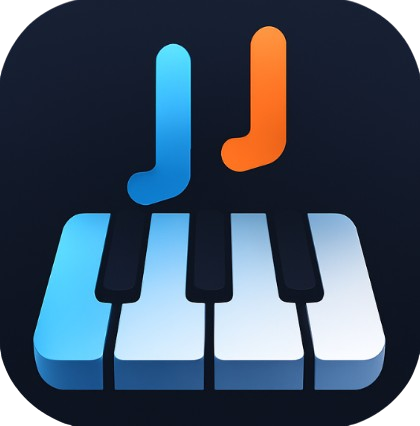
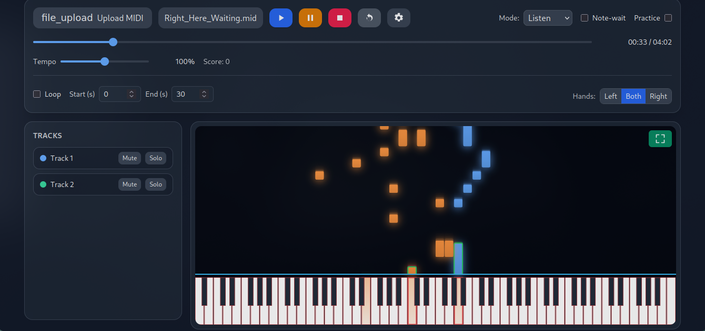

<p align="center">
  
  <br/>
  <h1 align=center>KeyMistry</h1>
  <h2 align=center>Web MIDI Piano Trainer</h2>
 </p>


<p align="center">
  
</p>


A modern, browser-based MIDI piano trainer built with Tailwind CSS, Tone.js, and the Web MIDI API. Load any MIDI file, visualize falling notes with a piano roll, connect your MIDI keyboard for interactive practice, and track your progress with a Guided Learning flow and a built‑in dashboard.


**Best for:**  
- Piano learners with a MIDI keyboard  
- Users who want structured, accuracy-driven practice  
- Desktop users on Chrome/Edge  

**Not for:**  
- Mobile/tablet use  
- Users without MIDI hardware

> ⚠️ **Desktop only**
> Web MIDI is unreliable on mobile. This app intentionally blocks mobile browsers.


Demo: https://bumblebee-3.github.io/KeyMistry/
---

## Features

- MIDI loader + quick reload
  - Upload any .mid/.midi and auto-persist the last song ("Load Previous")
- Transport and controls
  - Play, Pause, Stop, Restart; countdown overlay before starting
  - Tempo slider scales BPM while keeping visuals tightly synced to the audio clock
- Piano roll visualization
  - Crisp note fall synced to the audio clock (Tone.Transport + Tone.Draw)
  - Track/part colors, adjustable fall time, note radius, trails, glow, and hit line
  - Virtual keyboard with colored glow and red outlines for pressed keys
- Web MIDI I/O
  - Device selection (In/Out), MIDI Thru, Test Note, echo guard, CC64 sustain handling
  - Configurable Sustain Tail (ms) for smoother external note‑offs; All Notes Off on Stop
- Practice Mode (note‑wait)
  - Pauses just before the next chord/note group; resumes when you play the required notes
  - Early‑hit lookahead and octave tolerance (±0..2) for forgiving matching
  - Input timing offset calibration (±200 ms) to match your device/latency
  - Loop any range; per‑loop feedback (accuracy, timings)
- Guided Learning
  - Learn notes with chord waits, then practise Rhythm with continuous playback
  - Focus on one section or choose cumulative review
  - Exact pitch/octave matching; one attack scores once, repeated keys require release
  - Separate pitch accuracy, missed/extra notes, and real-time timing feedback
  - Two strong Rhythm attempts earn mastery; navigation does not award it
  - Gentle adaptive tempo per hand/phase, with saved progress
- Transpose & Key
  - Auto‑detects song key on load; adjust Key/Scale and Transpose with live re‑scheduling
  - Per‑song config (key/transpose) is remembered across sessions
- Dashboard
  - View per‑song completion, section accuracies, last played; sort and reset selectively
  - Replay the walkthrough tutorial; progress stored locally in the browser
- Robust MIDI parsing
  - Sanitizes malformed time‑signature meta events for better compatibility with @tonejs/midi
- Mobile‑safe
  - Mobile is intentionally blocked (Web MIDI is unreliable on mobile). Desktop browsers only.

---

## Quick Start

Prereqs: Node.js 18+ recommended.

```sh
# install deps for Tailwind build
npm install

# one-time production build of Tailwind CSS
npm run build:css

# run static server (uses npx serve)
npm start
```

Open the app in a desktop browser with Web MIDI (Chrome/Edge) and grant MIDI permissions when prompted. Entry points: `index.html` (landing), `app.html` (app), `dashboard.html` (progress).


## Using the App

1. MIDI Settings 
   - Select your MIDI Input and Output devices
   - Toggle MIDI Thru to echo input to output
   - Click Test Note to verify the output device
   - Adjust Sustain Tail (0–150 ms) to smooth external device note-offs
2. Load a MIDI
   - Click Upload and select a `.mid/.midi` file
   - Or click the previous-song button (it shows the saved filename)
   - The last loaded file is auto-loaded on startup
3. Controls
   - Play ▶, Pause ⏸, Stop ⏹, Restart ⟳
4. Practice
  - Switch Mode to Practice and enable Note‑wait (pauses before each required chord/note)
  - Choose Hand (Left/Right/Both) if your MIDI separates hands; set Loop start/end (seconds)
  - Start playback (countdown appears); play the required notes to resume
  - Per‑loop feedback shows accuracy and timing; Guided adds an end‑of‑stage overlay
5. Visualization
  - Adjust Note radius (Square/Soft/Pill), Fall time, Trails, Glow, and Hit line

6. Guided Learning
  - Click “Guided” to open the panel; stages progress Left → Right → Both (if applicable)
  - Sections are ~20s each; choose focused practice or cumulative review
  - When a stage ends, an accuracy overlay appears (locked briefly for ~1s), then choose Replay/Continue

7. Transpose & Key
  - Open Transpose & Key; use Auto‑Detect, then adjust Key/Scale or Transpose as needed
  - Per‑song settings persist; effective key is shown in the modal

8. Dashboard
  - Open Dashboard to view per‑song progress (completion, per‑section accuracies, last played)
  - Sort by Recent/Completion/Title; reset one song or all; replay the tutorial

---

## How It Works

- MIDI parsing: `@tonejs/midi` with a sanitizer for malformed time‑signature meta events
- Scheduling & audio: Tone.Transport for timing + Tone.Draw for visual sync; per‑track `PolySynth`
- Tempo: scales around the song’s original BPM (keeps visuals exactly in lockstep)
- MIDI Out: mirrors scheduled Note On/Off on track channels; CC64 (sustain) forwarded
- Sustain smoothing: Note Offs delayed by a configurable tail (ms) for external gear
- Practice engine
  - Groups close notes into chords; waits just before them (note‑wait)
  - Early‑hit lookahead, octave tolerance, and input timing offset calibration
  - Accuracy uses partial per‑note credit; full credit for satisfied chords
- Guided Learning
  - Cumulative stages across sections; explicit Continue/Replay control (no auto‑continue)
  - Final overlay reports accuracy and average timing (ms) with a short input lock

---


## Troubleshooting

- Web MIDI not showing devices
  - Use Chrome/Edge and run on HTTPS or `http://localhost:3000/`
  - Ensure OS sees your device, and it’s not grabbed exclusively by another app
  - Refresh device list in the MIDI Settings modal
- No sound from output device
  - Select the correct MIDI Output in settings
  - Use Test Note to verify
  - Try increasing Sustain Tail

---

## Development

This is a static client app with a local Tailwind build.
- Tailwind is built locally via PostCSS and output to `./css/tailwind.css` (linked from HTML)
- Source styles live in `./css/src/tailwind.css` (uses `@tailwind` directives)
- Tone.js and `@tonejs/midi` are imported as ESM from CDNs inside `./js/script.js`
- Editor: `.vscode/settings.json` silences harmless CSS warnings for compiled Tailwind output

Project structure (top‑level):

```
app.html        # main app
index.html      # landing/marketing
dashboard.html  # local progress overview
css/
  src/tailwind.css  # Tailwind source (with custom CSS)
  tailwind.css      # compiled output (built via scripts)
js/
  script.js         # app logic (module)
  dashboard.js      # dashboard UI logic (module)
assets/            # images, icons
songs/             # sample songs (mid/midi)
```

Useful scripts:

```sh
# Rebuild Tailwind on changes
npm run dev:css

# Production/minified build
npm run build:css
```

Start a local static server (`npm start` or `npx serve`) and open `app.html`.

Playback performance regression checks (Node.js 18+, no extra dependencies):

```sh
node --test tests/*.test.mjs
```

The piano roll indexes note intervals so each frame visits only visible notes,
including held notes and grouped practice chords. Tracks using the same soundfont
instrument share its decoded samples. Tests cover seeking, visibility boundaries,
shared loads, retries, and cancellation when songs change.


PRs and ideas are welcome.

---

## License

GPL V3.

## Author: Hridhuun Savant ([Bumblebee-3 (Github)](https://github.com/Bumblebee-3), [Website](https://bumblebee-2008.github.io/))

## Soundfont playback

Choose **MIDI & Visual Settings → Soundfont → Bank** to compare Musyng Kite (the default), FatBoy, and FluidR3. Existing saved bank choices are
preserved. MP3 and OGG are supported. Playback waits for active instruments;
public bank downloads retry jsDelivr, GitHub Raw, and GitHub Pages. Custom URL
templates use only the specified host. Bank changes pause playback.

General MIDI channel 10 (zero-based channel 9) uses a dedicated percussion kit,
not a melodic program. Standard drum notes 35–81 have separate samples; drum
identities remain unchanged by transposition. Hits decay naturally and closed
hi-hats choke open hi-hats. Drum tracks do not enter piano practice chords or
key detection. This is a standard GM kit; proprietary extended drum maps and
GS/XG kit-selection messages are not supported.

Sample sources and credits:

- [MIDI.js soundfonts](https://github.com/gleitz/midi-js-soundfonts#soundfonts-available):
  FatBoy and Musyng Kite (CC BY-SA 3.0), FluidR3 (CC BY 3.0), with upstream credits
  and license links. Samples stream from their hosts; no bank binaries are bundled.
- [WebAudioFont sound data](https://github.com/surikov/webaudiofontdata): Chaos GM
  percussion samples, served through jsDelivr with GitHub Raw fallback.

Required sample hosts are `cdn.jsdelivr.net`, `raw.githubusercontent.com`, and
`gleitz.github.io`. Playback errors display a message rather than silently
starting an unloaded instrument.

Sustain pedal (CC64) is applied per MIDI channel, including controller-only
tracks. Local audio holds notes through pedal release; external MIDI receives
pedal messages timestamped on the audio clock. Seeking/resuming restores pedal
state, and Stop clears queued MIDI output. A missing pedal-up is bounded by the
song end; drum one-shots ignore sustain. Sampled sounds still decay naturally
and cannot exceed the duration of their recorded sample.

Voice choices follow the MIDI's zero-based General MIDI program numbers. Saved
voice overrides are restored only when channel/program/track layout matches;
legacy filename-only overrides are ignored. Use **Instruments → Reset voices to
MIDI originals** to discard manual voice changes. External MIDI output sends
program changes before notes. The local drum bus is attenuated by approximately
11 dB relative to its raw samples to keep percussion from overpowering melodies.

Local playback respects per-channel MIDI volume (CC7) and expression (CC11),
including changes during held notes and restoration after seeking. Instruments
can share decoded samples while their voices use independent channel gain buses.
A master limiter reduces overload in dense full-song arrangements. These mix
controls also forward to external MIDI output on the playback clock.


## Guided practice workflow

1. Choose learning tracks and their Left/Right roles. Keep accompaniment and drums
   as Background. New arrangements prefer piano tracks, but track numbers do not
   reliably identify hands—review the assignments. Existing saved roles are kept.
2. Use **Learn notes** for exact pitches and chord shapes. The preview names notes,
   common chords/inversions, and intervals. A physically held key cannot satisfy
   a new repeated note; release it and press again, even with sustain down.
3. Switch to **Rhythm** when comfortable. Playback continues through mistakes so
   missed notes remain visible in the result. Extra key attacks reduce accuracy:
   `correct pitches / (expected pitches + extra attacks)`. Unison duplicates
   across tracks count as one playable key.
4. Review missed notes, extra attacks, the proportion within 150 ms, and average
   absolute timing error. Input timestamps and the input-offset calibration are
   measured in real time, including during waits and at slow tempos.
5. Mastery requires two consecutive strong Rhythm attempts (at least 90% pitch
   accuracy and 80% on time). Each phase remembers its tempo; suggested adjustments
   are five percentage points, bounded to 50–125%. Continue can move on without
   granting mastery. Existing saved mastery is preserved.

A new lesson starts at 70% tempo. Current-section practice is the default;
Cumulative review combines earlier sections. Changing sections/hands/style or
seeking restarts the attempt. Pausing stops scoring. MIDI keyboard input is
required; these scores assess key attacks and timing, not fingering technique
or how long a note is physically held. MIDI echo detection only applies to
MIDI Thru and uses a short real-time window.
